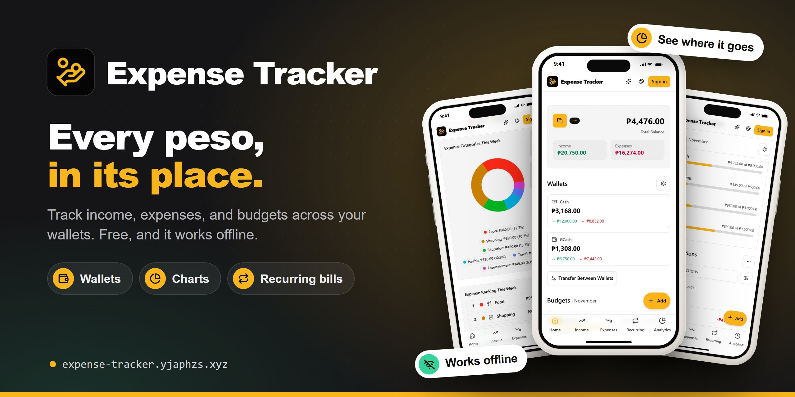
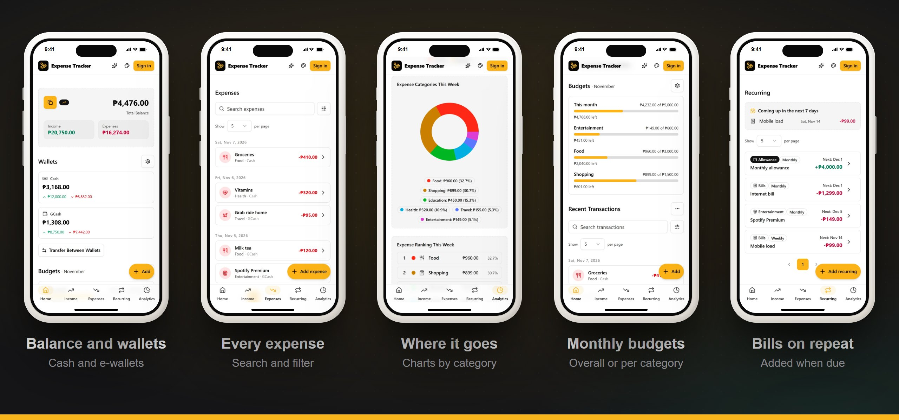

<p align="center">
  <a href="https://expense-tracker.yjaphzs.xyz">
    
  </a>
</p>

<h1 align="center">Expense Tracker</h1>

<p align="center">
  <b>Track the money you earn and spend across your wallets, with budgets and charts.</b><br />
  Free · No account needed · Works offline
</p>

<p align="center">
  <a href="https://expense-tracker.yjaphzs.xyz"><b>Open Expense Tracker</b></a>
  &nbsp;·&nbsp;
  <a href="https://app-hub.yjaphzs.xyz">More apps</a>
</p>

---

## At a glance

- **What it is:** a free money tracker that runs in your browser and can be installed like an app.
- **Who it's for:** anyone who wants to see where their money goes, from allowances to salaries.
- **What you need:** a phone or computer with a web browser. No sign-up, and it keeps working offline.
- **Where your data goes:** it stays in your browser unless you choose to sign in.
- **Good to know:** you type in your own amounts. It doesn't connect to banks or e-wallets. Amounts are in Philippine pesos (₱).

## Get started in 4 steps

1. **Open** [expense-tracker.yjaphzs.xyz](https://expense-tracker.yjaphzs.xyz). On a phone, you can also choose **Install** to add it to your home screen.
2. **Set up your wallets:** a Cash wallet is ready. Add your e-wallets and cards so each one has its own balance.
3. **Add an entry:** tap **Add**, pick income or expense, then enter the amount, category, wallet, and date.
4. **Check your Home tab:** your total balance, each wallet, and how much of this month's budget is left.

> [!TIP]
> Sign in with your email or Google account to keep your records safe and see them on all your devices.

## What you can do

### Track every peso
- Log income and expenses with a category, a short note, a date, and a wallet.
- Keep cash, e-wallets, and cards apart, each with its own balance.
- Move money between wallets. Transfers don't count as income or spending.
- Add your own categories, each with an icon.
- Search and filter your entries.

### Plan ahead
- Set **monthly budgets** for all your spending or per category, and see what's left.
- Add **recurring** bills and income (daily, weekly, every two weeks, or monthly). They add themselves when due, and you can pause them or set an end date.

### See where it goes
- **Analytics** by week, month, or overall, for income or expenses.
- Charts and a ranking of your top categories, with color palettes to choose from.

### Export and move your data
- Download your entries as **Excel** or **CSV**, or print a report and save it as PDF.
- Bring in entries from a CSV file.
- Move everything to another device with a **QR code**, or back it up to a file.

### Make it yours
- Light mode, dark mode, or match your device.
- Color schemes: Amber, Pink, Red, Green, Teal, Blue, Purple, Black, or any color you pick. Signed in, your choice follows you to your other devices.

## See it in action

<p align="center">
  
</p>

## Your data and privacy

- **Without an account:** everything stays in this browser on this device. Clearing your browser data erases it, so back it up with a QR code or a file, or sign in.
- **With an account:** your records are saved to your account and stay in step on all your devices.
- **No bank access:** the app never connects to your bank or e-wallet. It only knows what you type in.
- **You're in control:** delete your account and its data at any time from the **Account** page.
- Read the full [Privacy Policy](https://expense-tracker.yjaphzs.xyz/privacy-policy) and [Terms and Conditions](https://expense-tracker.yjaphzs.xyz/terms-and-conditions).

## Questions

<details>
<summary><b>Is it free?</b></summary>

Yes. Every feature is free, and you don't need an account to use it.
</details>

<details>
<summary><b>Does it work without the internet?</b></summary>

Yes. After your first visit, the app opens without the internet, and without an account everything keeps working offline. Syncing your account across devices needs a connection.
</details>

<details>
<summary><b>How do I install it on my phone?</b></summary>

Open the site and choose **Install** when the app offers it, or use your browser's **Add to Home Screen**.
</details>

<details>
<summary><b>Can I use a currency other than pesos?</b></summary>

Not yet. Amounts are shown in Philippine pesos (₱).
</details>

<details>
<summary><b>How do I move my records to a new phone?</b></summary>

Sign in on both devices, or use the QR code transfer or a backup file.
</details>

<details>
<summary><b>I found a problem or have an idea.</b></summary>

Email [jan@yjaphzs.xyz](mailto:jan@yjaphzs.xyz) or [open an issue](https://github.com/yjaphzs/expense-tracker/issues).
</details>

## Support

If the tracker helps you, you can [buy me a Ko-fi](https://ko-fi.com/yjaphzs). Thank you!

---

<details>
<summary><b>For developers</b></summary>

### Tech stack

- **Next.js** App Router, exported as a static site (`output: 'export'`), with a Serwist service worker
- **Firebase:** Hosting, Authentication, Firestore, Storage, and Cloud Functions
- **Tailwind CSS v4** + **shadcn/ui**, Recharts (analytics), xlsx-js-style (Excel export)
- Notes for contributors and AI agents: [CLAUDE.md](CLAUDE.md)

### Getting started

1. **Clone and install:**
   ```bash
   git clone https://github.com/yjaphzs/expense-tracker.git
   cd expense-tracker
   npm install
   ```

2. **Create a Firebase project** and a Web App in the [Firebase Console](https://console.firebase.google.com/), then enable:
   - **Authentication** → Sign-in methods: **Email/Password** and **Google**
   - **Firestore Database**
   - **Storage**
   - (optional) **App Check** with reCAPTCHA v3

3. **Configure environment variables:**
   ```bash
   cp .env.local.example .env.local
   # fill in the NEXT_PUBLIC_FIREBASE_* values from your Web App config
   ```

4. **Configure the email sender (Cloud Functions + Resend).** Verification and password reset
   emails are sent as branded HTML by Cloud Functions via
   [Resend](https://resend.com/docs/send-with-nodejs). The functions generate the action link and
   point it at the in-app `/auth/action` page. Add your domain in Resend, add the DKIM/SPF records
   it shows you, then create an API key. For local emulator testing:
   ```bash
   cp functions/.env.example functions/.env
   # fill in RESEND_API_KEY, EMAIL_FROM_EMAIL (e.g. no-reply@yjaphzs.xyz), APP_URL
   ```
   The email HTML is built from the `.hbs` sources in `functions/src/lib/email/templates/` with
   `npm run generate:emails`.

5. **Run the dev server:** `npm run dev`

6. **Check and build:**
   ```bash
   npm run lint && npm run typecheck && npm test
   npm run build   # static export in ./out
   ```

### Local Firebase emulators (optional)

```bash
npm install -g firebase-tools
firebase emulators:start   # Auth, Firestore, Storage, Functions, Hosting
```

### Deployment

Pushing to **`main`** runs [`.github/workflows/deploy.yml`](.github/workflows/deploy.yml): lint,
typecheck, and tests, then the static export, then **Functions → Hosting → Firestore rules →
Storage rules** to the single Firebase project. Pushes to `development` run the checks only.

GitHub repository configuration:

- **Variables** (`Settings → Secrets and variables → Actions → Variables`): every `NEXT_PUBLIC_*`
  value (app and Firebase). `NEXT_PUBLIC_FIREBASE_PROJECT_ID` also selects the deploy target.
  For email: `EMAIL_FROM_NAME`, `EMAIL_FROM_EMAIL`.
- **Secrets:** `GOOGLE_APPLICATION_CREDENTIALS_BASE64` (a base64-encoded Firebase service-account
  JSON key with deploy permissions) and `RESEND_API_KEY`.

The custom domain (`expense-tracker.yjaphzs.xyz`) is set under Firebase Hosting → Custom domains.

### References

- **Ko-fi button:** [CostasAK/react-kofi-button](https://github.com/CostasAK/react-kofi-button)
- **UI components, charts, and hooks:** [shadcn/ui](https://ui.shadcn.com/), [Recharts](https://recharts.org/)
- **Excel export:** [xlsx-js-style](https://github.com/gitbrent/xlsx-js-style)
- **QR transfer:** [qrcode.react](https://github.com/zpao/qrcode.react), [html5-qrcode](https://github.com/mebjas/html5-qrcode), [lz-string](https://github.com/pieroxy/lz-string)

</details>

## License

MIT. Made with ❤️ by [JPB](https://www.yjaphzs.xyz/), with Next.js and shadcn/ui.
